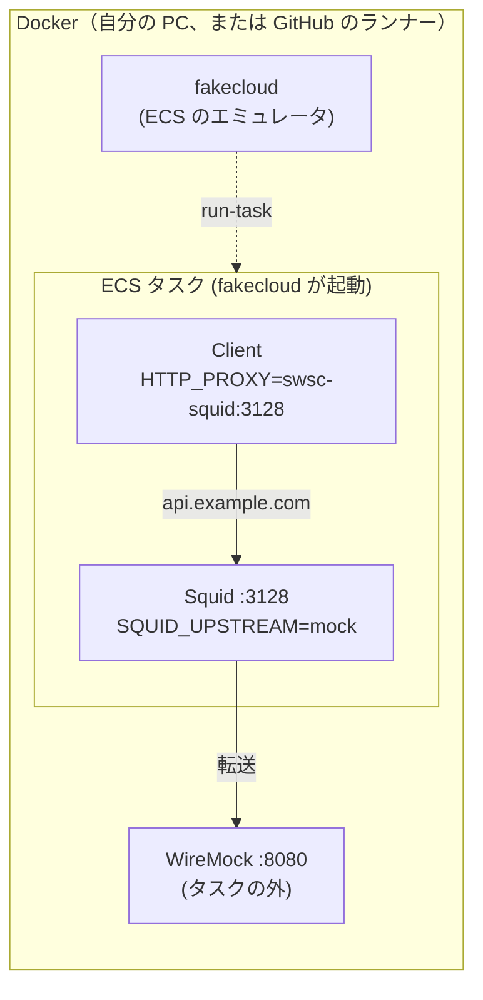
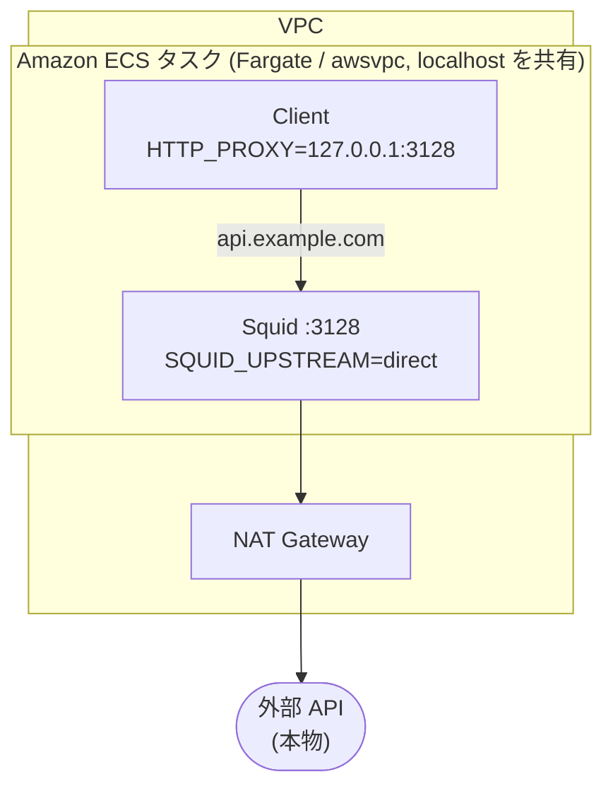

# アーキテクチャ

ECS のサイドカー構成（Squid プロキシ）を、ローカルと CI で ECS のエミュレータに載せて検証し、
同じタスク定義を AWS（Fargate）へデプロイできるようにする。この文書は、構成、技術スタック、設計判断の正本である。

```text
Client → Squid (:3128) → WireMock (:8080)      ローカル、CI（SQUID_UPSTREAM=mock）
Client → Squid (:3128) → 外部 API（HTTPS）       AWS（SQUID_UPSTREAM=direct）
```

## ディレクトリ構成

ディレクトリ、ファイルの順に、アルファベット順で並べる。ファイルは、リポジトリのルート直下のものだけを示す。

```text
.
├── .github/                    # GitHub の設定
│   └── workflows/              #   CI（e2e-test.yml）
├── cdk/                        # AWS 用の CDK（TypeScript）
│   ├── bin/                    #   エントリポイント
│   └── lib/                    #   スタック、タスク定義の生成、アセットの用意
├── docs/                       # 手順と決定の記録
├── ecs/                        # タスク定義の雛形と、Squid のイメージ
│   └── squid/                  #   Squid の Dockerfile と起動スクリプト
├── scripts/                    # 入口（e2e.sh）、起動と停止、シナリオの実行、タスク定義の生成と検査
│   └── lib/                    #   ツールの版の照合
├── specs/                      # 仕様
│   └── MVP/                    #   要件の受け入れ条件と、確認結果の記録（spec.md）
├── squid-config/               # Squid の設定と許可リスト
├── test-client/                # Client（リトライ付きの HTTP クライアント）
├── wiremock-scenarios/         # WireMock の応答定義
│   ├── __files/                #   応答の本文
│   └── mappings/               #   リクエストと応答の対応（JSON）
├── .dockerignore
├── .gitignore
├── .gitleaks.toml              # 識別情報の検査の設定
├── .markdownlint.json
├── .shellcheckrc
├── AGENTS.md                   # 開発のルール
├── ARCHITECTURE.md             # この文書
├── Dockerfile.test-client      # Client のイメージ
├── mise.lock                   # 検査ツールの固定版
├── mise.toml
├── package-lock.json
├── package.json                # npm run の入口と、文書の検査
└── README.md
```

## 技術スタック

| 区分 | 技術 | 版 | 用途 |
| --- | --- | --- | --- |
| プロキシ | Squid（`ubuntu/squid` の派生イメージ） | `latest`（固定していない） | 許可ドメインだけを中継する。HTTPS は `CONNECT` で通すだけで、復号しない |
| モック | WireMock | 3.13.1 | 外部 API の応答（正常、エラー、遅延）を JSON で定義して返す |
| Client | シェルスクリプトと curl（`alpine`） | alpine 3.20 | リトライとタイムアウトを持つテスト用の HTTP クライアント |
| ECS エミュレータ | fakecloud | 0.51.0（ダイジェストで固定） | ローカルと CI で、タスク定義を `run-task` して動かす。AGPL-3.0 |
| イメージのレジストリ | `registry` | 2.8.3（ダイジェストで固定） | エミュレータが pull するイメージの置き場 |
| IaC | AWS CDK（TypeScript） | aws-cdk-lib 2.276.0、aws-cdk 2.1148.1 | AWS へのデプロイ。タスク定義は雛形から作る |
| タスク定義の雛形 | `ecs/task-definition.template.json` | - | タスク定義の唯一の元 |
| スクリプト | POSIX sh、Python 3（標準ライブラリだけ）、curl | - | 起動、検査、収集、停止。タスク定義の生成と検査 |
| 検査ツール | shellcheck、actionlint、gitleaks、jq | `mise.toml` と `mise.lock` で固定 | シェル、ワークフロー、識別情報の検査 |
| 文書の検査 | markdownlint-cli2 | 0.24.0 | Markdown の検査 |
| CI | GitHub Actions（`ubuntu-24.04`） | アクションはコミット SHA で固定 | 検査、E2E、`cdk synth`、`check-cdk` |

### 実行環境の前提

| 項目 | 内容 |
| --- | --- |
| Docker | ローカルと CI で必須。`docker run` で直接起動する（Compose は使わない） |
| Node.js | 22 以上。`npm run` の入口と CDK で使う |
| Python 3、curl | スクリプトが使う |
| mise | 2026.11.3 以上。`mise install --locked` で検査ツールを固定版で入れる |
| AWS | ローカルと CI の E2E には不要。AWS へのデプロイだけに要る（利用者の認証情報で行う） |

## 構成要素

| 要素 | 役割 | 置き場所 |
| --- | --- | --- |
| Client | 外部 API 宛ての通信を、同じタスクの Squid 経由で送る | `test-client/`、`Dockerfile.test-client` |
| Squid | 許可リストのドメインだけを中継する。転送先は `SQUID_UPSTREAM` で切り替える | `squid-config/`、`ecs/squid/` |
| WireMock | ローカルと CI だけで動く。AWS では起動しない | `wiremock-scenarios/` |
| fakecloud とレジストリ | ローカルと CI だけで動く。ECS のタスクをコンテナで実行する | `scripts/e2e-runner.sh` |
| CDK | AWS 用のスタック（VPC、クラスタ、ログ、ロール、タスク定義） | `cdk/` |

WireMock は、タスク定義には入っていない。タスク定義は `client` と `squid` の2コンテナだけで、
ローカルと CI では WireMock を、タスクの外のコンテナとして別に起動する。

## 環境ごとの構成

Client と Squid は、どの環境でも同じ2コンテナである。違いは、Squid の転送先と、Client から Squid への宛先である。

| | ローカル | CI | AWS |
| --- | --- | --- | --- |
| 動く場所 | 自分の PC の Docker | GitHub のランナーの Docker | ECS Fargate |
| タスクの起動 | fakecloud の `run-task` | 同左 | ECS の `run-task`（利用者が実行） |
| Client から Squid への宛先 | 別名 `swsc-squid:3128` | 同左 | `127.0.0.1:3128`（`awsvpc` で localhost を共有） |
| WireMock | あり | あり | なし |
| Squid の転送先 | WireMock（`mock`） | WireMock（`mock`） | 外部 API（`direct`） |
| タスク定義の作り方 | `render --profile local` | 同左 | CDK、または `render --profile production` |

### ローカルと CI

CI は、動く場所が GitHub のランナーで、実行するのがワークフローである点だけがローカルと違う。構成は同じである。



### AWS（ECS Fargate）

WireMock は無く、起動しない。Squid は外部 API へ直接つなぐ（`SQUID_UPSTREAM=direct`）。



## 環境変数 `SQUID_UPSTREAM`

Squid の転送先は `SQUID_UPSTREAM` で切り替える。値はタスク定義の Squid コンテナの `environment` に入る。
`mock` か `direct` のどちらかで、それ以外は Squid の起動が失敗する。

| 値 | Squid の転送先 | 使う環境 | 追加の環境変数 |
| --- | --- | --- | --- |
| `mock` | WireMock | ローカル、CI | `SQUID_MOCK_HOST`、`SQUID_MOCK_PORT` |
| `direct` | 外部 API | AWS | なし |

## タスク定義の一本化

タスク定義の元は `ecs/task-definition.template.json` の1つだけである。環境ごとに、同じ雛形から作る。

```text
ecs/task-definition.template.json
   ├─ render --profile local       → ローカルと CI の完成版（WireMock あり）
   ├─ render --profile production  → AWS の完成版（手動）
   └─ cdk/lib/taskdef.ts           → AWS の完成版（CDK）
```

| 検査 | 内容 |
| --- | --- |
| `check-production` | 完成版が本番向けか。`SQUID_UPSTREAM` が `direct` で、`SQUID_MOCK_*` が残っていない |
| `check-cdk` | `cdk synth` の出力が、`render` の本番用の出力と、イメージ、ログ、ロール以外で一致する |

CDK のコードには、コンテナ名、環境変数、ヘルスチェック、依存関係を書かない。AWS 用の定義がずれていないことは、
`check-cdk` が CI で確かめる。

## 1回の Client 実行の流れ（ローカルと CI）

Client を1回実行するごとに、タスクを1つ起動する。

1. スクリプトが、`run-task` でタスクを起動する（Client の環境変数は `overrides` で渡す）。
2. fakecloud が、タスクごとに専用の Docker ネットワークを作り、Squid と Client のコンテナを起動する。
3. スクリプトが、タスクのネットワークに WireMock を接続し、Squid に別名 `swsc-squid` を付ける。
4. Client は、Squid が healthy になってから起動する（`dependsOn: HEALTHY`）。
5. スクリプトが、Client の出力と終了コードを取り、タスクのコンテナとネットワークを消す。

## ネットワークと公開範囲

ホストへ公開するのは、次の3つだけである。公開先は、ホストの `127.0.0.1` に限る。
同じホストのテストクライアントやブラウザからは接続でき、他のホストや別マシンからは接続できない。

| 対象 | 接続先 | 用途 |
| --- | --- | --- |
| WireMock | `127.0.0.1:8080` | モックの応答。管理 API（`/__admin`）も同じ公開範囲で届く |
| fakecloud | `127.0.0.1:14566` | ECS のエミュレータの API。Docker のソケットを持ち、ホストの Docker を操作できる |
| レジストリ | `127.0.0.1:15000` | ビルドしたイメージの置き場 |

Squid（3128）は、ホストへ公開しない。タスクごとの専用ネットワークの中だけで待ち受ける。
タスク定義に `portMappings` を書かないのは、fakecloud が書かれたポートをホストの全インターフェースへ公開するためである。
`awsvpc` では、同じタスクのコンテナ間の通信に `portMappings` は要らない。

公開の設定は、`scripts/e2e-runner.sh` が各コンテナを起動するとき、ホスト IP を `127.0.0.1` と明示して行う
（`-p 127.0.0.1:8080:8080`、`-p 127.0.0.1:14566:4566`、`-p 127.0.0.1:15000:5000`）。
IPv6 の `::1` は公開しない。`localhost` は環境によって `::1` へ解決されるため、接続先は `127.0.0.1` と書く。
設定は、`docker ps --filter label=swsc.managed=true --format '{{.Names}} {{.Ports}}'` で確かめられる。
3つのポートの欄が `127.0.0.1:<ポート>->...` で、`0.0.0.0` と `::` を含まない。

### Squid の送信元制御

Squid は、送信元が `127.0.0.0/8` と RFC 1918 の私設範囲（`10.0.0.0/8`、`172.16.0.0/12`、`192.168.0.0/16`）にある
要求だけを許可ルールに通す。範囲外は `http_access deny all` で拒否する。
タスクのネットワークのサブネットは固定しない。Docker は起動のたびに空いているサブネットを割り当てるためである。
Docker の `default-address-pools` を RFC 1918 の外へ設定した環境では、許可ドメインの要求が 403 になる。
そのときは、`squid-config/squid.conf` の `acl local_src` に、そのサブネットを追加する。

### 許可ネットワークを採用しない理由

ループバック以外の端末から、Squid や WireMock へ接続できる設定は採用しない（2026-11-03 に承認）。

- 既存の手順と検査は、すべてホストの `127.0.0.1` から接続する。別ホストから使う手順も検査もない。
- 設定項目にすると、誤設定で全インターフェースの公開へ戻せてしまう。
- 範囲の指定方法と検査の保守費用が、利用の実態に見合わない。

別マシンから WireMock を使う必要があるときは、利用者側で SSH のポートフォワードを使う
（`ssh -N -L 8080:127.0.0.1:8080 <REMOTE_USER>@<REMOTE_HOST>`）。Squid はホストへ公開していないため、転送できない。
LAN 上の別端末やリモートの CI ランナーから、プロキシへ直接接続する運用が必要になったら、この決定を見直す。

### AWS のネットワーク

| 項目 | 内容 |
| --- | --- |
| サブネット | プライベートサブネットと NAT Gateway 1つ |
| セキュリティグループ | アウトバウンドの 443 だけ。インバウンドは作らない |
| VPC Block Public Access | アカウント全体で有効な場合に備え、この VPC だけ `allow-egress` で除外する |

### 症状と対処

| 症状 | 原因 | 対処 |
| --- | --- | --- |
| 別マシンや別コンテナから接続が拒否される、またはタイムアウトする | 公開先がホストの `127.0.0.1` だけのため | SSH のポートフォワードなど、利用者側の手段を使う |
| `localhost` への接続が失敗する | 一部のクライアントは `localhost` を `::1` へ解決する。`::1` は公開していない | 接続先を `127.0.0.1` に直す |
| 許可ドメインの要求が HTTP 403 になる | 送信元が `local_src` の範囲外になった | `squid-config/squid.conf` の `acl local_src` に、そのサブネットを追加する |
| ホストから `127.0.0.1:3128` へ接続できない | Squid はホストへ公開していない | Client の経路（タスクのネットワークの中）から送る |
| 起動時にポート 8080、14566、15000 のどれかが使用中で失敗する | 別のプロセスが同じポートを使っている | そのプロセスを止める |

## 設計判断

### ECS エミュレータの選定

ローカルと CI で、AWS と同じ完成版のタスク定義を `run-task` で動かすために、エミュレータを比べた。結論は fakecloud である。
確認は 2026-11-12 に、ローカルの Docker（Colima）で行った。

求めた条件は、次の5つである。

1. 完成版のタスク定義を、ECS の API（`register-task-definition`、`run-task`）で実行できる。
2. コンテナを実際に起動する（Client と Squid の実通信で、リトライとタイムアウトを確かめるため）。
3. `healthCheck` と `dependsOn: HEALTHY` が効く（Client は Squid が待ち受けてから起動する必要があるため）。
4. 同じタスクのコンテナが `127.0.0.1` を共有する（AWS の `awsvpc` と同じにするため）。
5. 無料で、アカウントやトークンが要らない（CI で使うため）。

4つ目は、どの候補も満たさなかった。そのため、Client のプロキシを Squid の別名にして補った。

| 候補 | ライセンス | ECS | 結果 |
| --- | --- | --- | --- |
| MiniStack 1.5.37 | MIT | コンテナを実行する | 条件 3 を満たさず、不採用 |
| AWS Emulator（`aws/aws-emulator`） | CC0 | API はあるが、コンテナの実行は確認できなかった | 動かしていない。実通信の検証には使えない見込みで、不採用 |
| fakecloud 0.51.0 | AGPL-3.0 | コンテナを実行する | 採用 |
| Floci | MIT | コンテナを実行するとされる | 試していない |
| LocalStack | 独自 | 有料 | 2026 年 3 月にコミュニティ版をやめ、アカウントとトークンが必要になったとされる。対象外 |
| moto、kumo | Apache-2.0、MIT | モックが中心とされる | 試していない |

#### 確かめたこと

| 確認事項 | MiniStack | fakecloud |
| --- | --- | --- |
| 登録、`run-task`、コンテナの起動 | できた | できた |
| `healthCheck` | 反映されない | 反映された |
| `dependsOn: HEALTHY` | 効かない。Client が Squid を待たずに動いた | 守られた |
| 同じタスクの `127.0.0.1` | 共有しない（コンテナごとに別の `bridge`） | 共有しない（タスクごとに専用のネットワーク。`taskRoleArn` を付けてもコンテナごとに別の名前空間） |
| コンテナ名 | `ministack-ecs-<タスクIDの先頭8文字>-<名前>`。別名の指定もない | `<タスクID>-<名前>`。毎回変わる |
| ローカルにしか無いイメージ | - | pull が拒否され `TaskFailedToStart` になる。レジストリが要る |
| `portMappings` | `awsvpc` では公開されない | 書いたポートをホストの全インターフェースへ公開する |

MiniStack で、Squid に別名を付けて Client を向ける案も、3 回試した。すべて失敗した。名前を解決できないか、Squid が起動前で
接続できなかった。Client には接続の再試行がなく、`dependsOn: HEALTHY` も効かないため、競合を避けられなかった。
fakecloud では、`dependsOn: HEALTHY` が効くため、同じ方法が成立した。

AWS Emulator は、README と `RunTask` のソースの冒頭が、タスクを `PENDING` で記録し、`RUNNING` への移行を
「時計で決まる」と書いている。コンテナを起動する記述は見つからなかった。ECS の API の応答だけを確かめる用途なら、候補になりうる。

#### 残る差とリスク

| 項目 | 内容 |
| --- | --- |
| AWS との差 | ローカルと CI の Client のプロキシは `swsc-squid:3128`。AWS 用は `127.0.0.1:3128`。差は環境変数の値だけにしている |
| Docker のソケット | fakecloud はホストの Docker を操作できる。公開先を `127.0.0.1` に限り、CI は使い捨てのランナーで動かす |
| ライセンス | fakecloud は AGPL-3.0。社内のローカル開発と CI での利用を想定している。製品へ同梱するなら見直す |
| 成熟度 | fakecloud は 2026 年に出た新しいプロジェクトで、版とダイジェストを固定している。上げるときは、全検査をやり直す |

#### 見直しの条件

- MiniStack が `healthCheck` と `dependsOn: HEALTHY` を反映し、コンテナの別名を指定できるようになった。
- fakecloud が、同じタスクのコンテナで `127.0.0.1` を共有できるようになった。Kubernetes のバックエンド
  （`FAKECLOUD_CONTAINER_BACKEND=k8s`）は Pod を使うため共有する見込みだが、試していない。
- AWS Emulator が、ECS のタスクをコンテナで実行するようになった。
- fakecloud のライセンスや保守の状況が、利用の条件に合わなくなった。

出典: [比較記事](https://codenote.net/en/posts/localstack-archived-oss-alternatives-comparison/)、
[fakecloud の README](https://github.com/faiscadev/fakecloud)、[aws/aws-emulator](https://github.com/aws/aws-emulator)。

## 既知の差と制約

| 項目 | 内容 |
| --- | --- |
| `127.0.0.1` の共有 | fakecloud も MiniStack も、同じタスクのコンテナで共有しない。ローカルと CI は Squid の別名で代替する。AWS 用の完成版は `127.0.0.1:3128` のまま |
| Squid 再起動後の確認 | タスクの Client は1回で終わるため、同じタスクのネットワークで Client を追加で実行する。この1件だけ ECS を通らない |
| タスクが止まらない | Squid が `essential` のため、Client が終わってもタスクは止まらない。AWS では手動で止める |
| 直接接続の遮断 | Client が `HTTP_PROXY` を使わずに外部へ接続すると通る。閉域は、Squid の許可リストで担保する |
| 範囲 | `register-task-definition` と `run-task`（タスクとしての起動）まで。サービス、ローリングデプロイ、Auto Scaling、ロードバランサーは対象外 |
