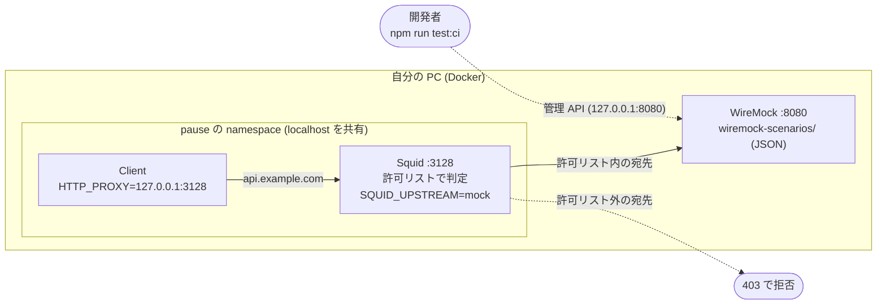
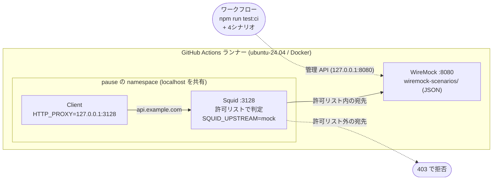
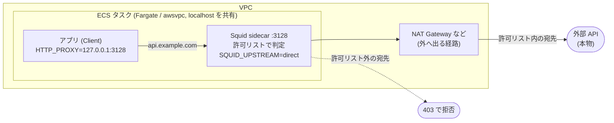

# Squid WireMock Sidecar E2E Test Framework

ECS のサイドカー（Squid プロキシ）構成をローカルと CI でエミュレートし、
外部 API のエラー応答や遅延を含む E2E テストを実施する検証用の環境。

```text
Test Client → Squid Proxy (127.0.0.1:3128) → WireMock (127.0.0.1:8080)
```

本番 ECS では awsvpc ネットワークモードでタスク内のコンテナが localhost を共有する。
同じ構成を、pause コンテナと共有する namespace で再現し、クライアントのリトライやタイムアウトを確かめる。

## 構成図

違いは WireMock の有無だけです。Client と Squid は、どの環境でも同じ2コンテナで、localhost を共有します。

### 環境変数 `SQUID_UPSTREAM`

Squid の転送先は、環境変数 `SQUID_UPSTREAM` で切り替えます。
値は `mock` か `direct` のどちらかで、それ以外の値だと Squid の起動が失敗します。
値はタスク定義の Squid コンテナの `environment` に入ります。ローカルと CI は `mock`、AWS 本番は `direct` です。

| 値 | 許可ドメイン宛て | 許可外のドメイン宛て |
| --- | --- | --- |
| `mock` | WireMock にだけ転送する。インターネットには出ない | 403 で拒否する。どこにも転送しない |
| `direct` | 外部 API へ直接つなぐ | 403 で拒否する。どこにも転送しない |

許可ドメインは `squid-config/whitelist.txt` に書きます。許可外を拒否するのは `http_access deny all` で、`SQUID_UPSTREAM` の値に関わらず同じです。
`direct` では、WireMock への転送の設定を外し、許可ドメインへの直接接続を許可する設定に置き換えます（`ecs/squid/derive-config.sh`）。
判定をするのは Squid です。WireMock は、許可リスト内の宛先として届いた要求に、定義した JSON のパスにだけ応答します。
定義が無いパスには、WireMock の既定の 404 が返ります。
ただし Client が `HTTP_PROXY` を使わずに直接つなぐと、Squid を通らずに外へ出られます。この経路は塞いでいません。

### ローカル

自分の PC の Docker で動かします。pause コンテナが network namespace を持ち、Client と Squid が参加します。
WireMock は別のコンテナで、同じ Docker ネットワークに置きます。



### CI（GitHub Actions）

構成はローカルと同じです。違うのは、動く場所が GitHub のランナー（`ubuntu-24.04`）であることと、
実行するのが開発者ではなくワークフローであることです。



### AWS 本番（ECS Fargate）

WireMock は無く、起動しません。Squid は、許可リスト内の宛先を外部 API へ直接つなぎ、許可リスト外は 403 で拒否します（`SQUID_UPSTREAM=direct`）。
ECS タスクは `awsvpc` モードで、Client と Squid が localhost を共有します。



| | ローカル | CI | AWS 本番 |
| --- | --- | --- | --- |
| 動く場所 | 自分の PC の Docker | GitHub のランナーの Docker | ECS Fargate |
| Client と Squid | pause の namespace を共有 | 同左 | `awsvpc` で localhost を共有 |
| WireMock | あり | あり | **なし** |
| Squid の転送先 | WireMock (`mock`) | WireMock (`mock`) | 外部 API (`direct`) |
| 起動する人 | 開発者 | ワークフロー | ECS |

## ローカルでの実行とテスト

初回だけ、検査ツール（shellcheck、actionlint、gitleaks、jq）を固定版で入れる。

```bash
mise install --locked
```

E2E（Docker を使う。CI と同じ内容）:

```bash
npm run test:ci                                                              # 起動、検査、収集、停止を続けて実行する
sh scripts/e2e.sh test:ci normal error-500-then-200 ratelimit-429 slow-5000  # 4シナリオ
sh scripts/e2e.sh test:ci error-500-then-200                                 # 1シナリオだけ
```

1つずつ操作するとき:

```bash
npm run start      # WireMock、pause、Squid を起動する
npm run test       # Client を実行して検査する
npm run logs       # コンテナのログを表示する
npm run stop       # 起動したコンテナとネットワークを削除する
npm run clean      # stop に加えて生成物と収集ログを削除する
```

コミット前の検査（ツールを直接実行する）:

```bash
git ls-files -z '*.sh' | xargs -0 "$(mise which shellcheck)" -s sh -S style --
"$(mise which actionlint)" -shellcheck "$(mise which shellcheck)" .github/workflows/e2e-test.yml
"$(mise which gitleaks)" dir . --config .gitleaks.toml --redact --no-banner --exit-code 1
npm run lint:md
```

固定ポート（8080、3128）は入口のロックで1つの実行だけに限る。並列に実行しない。

## AWS 本番へのデプロイ

このリポジトリは、デプロイそのものを実行しない。本番向けのタスク定義を作り、検査するところまでを行う。
イメージの作成と ECR への push、ECS への登録は、利用者の環境で行う。

1. 本番向けのタスク定義を作る。本番は `--profile production --upstream direct` だけを受け付ける（WireMock は指定できない）。

   ```bash
   python3 -B scripts/e2e-taskdef.py render \
     --template ecs/task-definition.template.json --out taskdef-production.json \
     --client-image <ECR のホスト>/<client のリポジトリ>:<タグ> \
     --squid-image <ECR のホスト>/<squid のリポジトリ>:<タグ> \
     --profile production --upstream direct
   ```

2. 本番向けの条件を満たすか検査する。合格すると `OK: 本番向けの検査に合格` と出る。

   ```bash
   sh scripts/e2e.sh check-production taskdef-production.json
   ```

3. 検査を通ったファイルを、ECS に登録する（このリポジトリは実行しない。例）。

   ```bash
   aws ecs register-task-definition --cli-input-json file://taskdef-production.json
   ```

Squid のイメージは `ecs/squid/Dockerfile`、Client のイメージは `Dockerfile.test-client` から作る。
タスク定義にはロールやログの設定が要る場合がある。登録前に、利用者の環境の要件に合わせて確かめる。

## 構成

| 場所 | 役割 |
| --- | --- |
| `squid-config/` | Squid の設定と許可ドメイン |
| `wiremock-scenarios/` | WireMock の応答定義（JSON） |
| `test-client/` | リトライ付きの HTTP クライアント |
| `ecs/` | ECS タスク定義のテンプレートと Squid のイメージ |
| `scripts/` | 入口（`e2e.sh`）、起動と停止、4シナリオの実行（`e2e-scenarios.sh`） |
| `.github/workflows/e2e-test.yml` | CI（shellcheck、actionlint、gitleaks、test:ci） |

## シナリオ

| シナリオ | 結果 | 目的 |
| --- | --- | --- |
| `normal` | 200 | 正常系 |
| `error-500-then-200` | 500 の後に 200 | 再試行して成功する |
| `ratelimit-429` | 429 が続く | 再試行を使い切る |
| `slow-5000` | 5 秒の遅延 | タイムアウトの処理 |

詳しくは [E2Eテスト](docs/E2Eテスト.md)、[シナリオの隔離と追加](docs/シナリオ隔離.md)、
[ポート公開範囲](docs/ポート公開範囲.md)、[ローカル実行とCI](docs/ローカル実行とCI.md) を参照。

## 前提

- Docker（`docker run` で直接起動する。Compose は使わない）
- Node.js 22+（`npm run` の入口として使う）
- curl
- mise 2026.11.3 以上。`mise install --locked` で shellcheck、actionlint、gitleaks、jq を固定版で導入する

## License

MIT

## Contact

Developed by <satoshi.kaneyasu@serverworks.co.jp>
