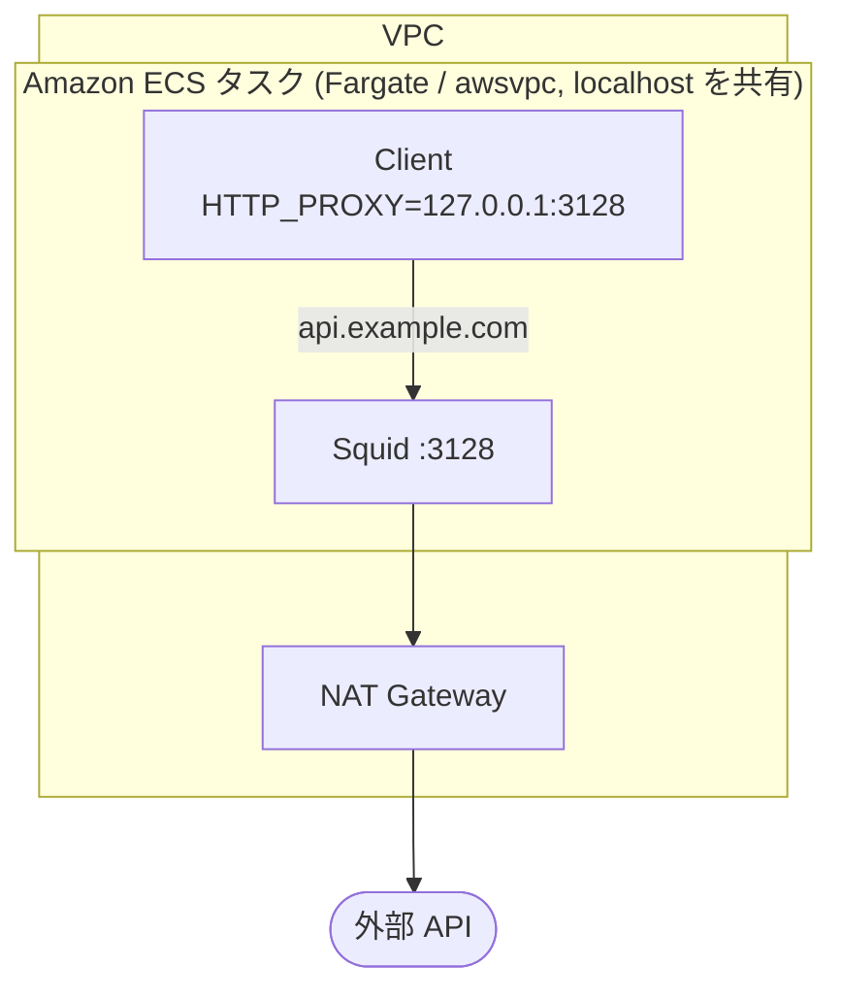
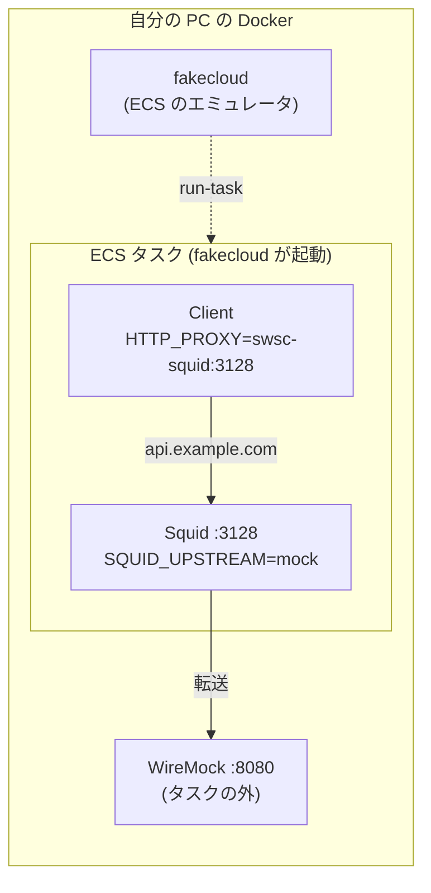

# ECS のサイドカーで外部 API を制御し、同じ定義でテストする

ECS のタスクに Squid をサイドカーとして置くと、アプリを変えずに、外部 API への通信を制御できる。
その構成の、エラー応答や遅延に対するリトライとタイムアウトを、ローカルと CI と AWS で、できるだけ同じタスク定義でテストした。
この記事は、その設計と、試して分かったことをまとめたものである。

構成と設定の正本は [アーキテクチャ](../ARCHITECTURE.md)、テストの手順は [テスト方式](テスト方式.md)、
AWS へのデプロイの手順は [AWS へのデプロイ](AWSへのデプロイ.md) にある。この記事は、それらを読む前の全体像と、判断の理由を説明する。

## はじめに

作ったものは、次の3つを組み合わせたテスト基盤である。

| 要素 | 役割 |
| --- | --- |
| Squid（サイドカー） | アプリの外部 API 宛ての通信を、許可したドメインだけ通す |
| WireMock | 外部 API の代わりに、正常な応答、エラー、遅延を返す |
| fakecloud | ECS のエミュレータ。AWS と同じタスク定義を、ローカルと CI で動かす |

```text
Client → Squid (:3128) → WireMock (:8080)      ローカル、CI
Client → Squid (:3128) → 外部 API（HTTPS）       AWS（WireMock なし）
```

## Amazon ECS と Squid によるコンテナのサイドカー戦略

### 外部 API との通信を制御する

外部 API と通信するシステムでは、「どこへ出ていけるか」を制御したいことが多い。
セキュリティグループとネットワーク ACL は、IP アドレスとポートで制御する。しかし、外部 API の IP は変わるうえ、
CDN の裏にあれば多数の IP が同じドメインを共有する。ドメインで制御するには、アプリケーション層のプロキシが要る。

ECS のサイドカーパターンは、これに向く。同じタスクに Squid のコンテナを置き、アプリ（Client）に
`HTTP_PROXY=http://127.0.0.1:3128` を渡す。`awsvpc` ネットワークモードでは、同じタスクのコンテナが localhost を共有するため、
アプリは同じタスクの Squid に届く。アプリのコードは変えない。



許可するドメインは、Squid の設定で決める。

```text
acl api_domains dstdomain "/etc/squid/whitelist.txt"
http_access allow local_src api_domains
http_access deny all
```

`whitelist.txt` に書いたドメイン（このリポジトリでは `api.example.com`、`api-staging.example.com`、`httpbin.org`）への要求だけを通し、
それ以外は 403 で拒否する。HTTPS の要求は、Client が `CONNECT` でトンネルを開く。Squid は中身を復号せず、
`CONNECT` の宛先ホスト名だけで、許可するかを決める。そのため、証明書の配布は要らない。

制約もある。Squid が見えるのは、宛先のホストとポートだけである。トンネルの中のパスやステータスコードは見えない。
また、Client が `HTTP_PROXY` を使わずに外部へ直接接続すると、この制御は効かない。プロキシの許可リストは、
ネットワークの遮断ではなく、アプリが守る前提の上に立つ制御である。

### 外部 API と通信する機能におけるテストの課題

外部 API と通信する機能には、正常系よりも、異常系の振る舞いにバグが出やすい。

- 500 や 503 が返ったときに、再試行するか。待ち時間は妥当か。回数に上限はあるか。
- 429 が `Retry-After` を付けて返ったときに、その秒数に従うか。
- 応答が遅いときに、タイムアウトするか。再試行しないか。

これらを本物の API で確かめるのは難しい。エラーを任意のタイミングで起こせず、レート制限は本番の枠を使い、結果は毎回変わる。
アプリの中でモックに差し替える方法もあるが、それでは、プロキシの設定ミスや許可リストの漏れという、本番で起きる問題を通らない。
本番と同じ「プロキシを通る経路」で、決まった異常を再現する必要がある。

### WireMock による HTTP ベースの API モックサーバー

WireMock は、HTTP のモックサーバーである。リクエストと応答の対応を JSON で書く。
たとえば「最初の1回は 500、2回目から 200」は、状態を持つシナリオで書く。

```json
{
  "name": "error-500-then-200",
  "scenarioName": "error-500-then-200",
  "requiredScenarioState": "Started",
  "newScenarioState": "Succeeded",
  "request": { "method": "GET", "urlPath": "/api/error-500-then-200" },
  "response": { "status": 500, "bodyFileName": "error-500.json" }
}
```

2つ目のファイルに `requiredScenarioState: Succeeded` と `status: 200` を書く。ほかに、`Retry-After: 2` を付けた 429 や、
`fixedDelayMilliseconds: 5000` の遅延も、同じ形式で定義する。

WireMock には、管理 API がある。テストごとに `POST /__admin/reset` で、マッピング、受信の記録、シナリオの状態を初期に戻せる。
受信の記録は、「何回呼ばれたか」の検査に使う。再試行が実際に起きたかは、この回数で確かめる。

Squid は、許可リストのドメイン宛ての要求を、WireMock へ転送する。

```text
cache_peer wiremock parent 8080 0 no-query
cache_peer_access wiremock allow api_domains
never_direct allow api_domains
```

Client から見ると、`api.example.com` を叩いているのに、応答は WireMock が返す。
本番と同じ経路（Client → Squid → 宛先）を通り、宛先だけが違う。

## ローカルと CI、そして AWS 環境においてできるだけ同じ定義でテストする

テスト環境を `docker run` や Docker Compose で別に組むと、本番のタスク定義とずれる。環境変数、起動順、ヘルスチェック、
依存関係のどれかが違えば、テストが通っても、本番で動く保証にならない。

そこで、ローカルと CI でも、AWS と同じタスク定義を、ECS の API（`register-task-definition` と `run-task`）で実行する。
そのために、ECS のエミュレータを使う。

### fakecloud による AWS 環境のエミュレーション

fakecloud は、AWS のエミュレータである。ECS の API を受け、タスクのコンテナを Docker で実際に起動する。
`healthCheck` と `dependsOn: HEALTHY` も効く。呼び出しは、`curl` で ECS の JSON の API を叩くだけで足りる。
AWS CLI と認証情報は要らない。

動かすには、次の準備が要る。

| 準備 | 理由 |
| --- | --- |
| Docker のソケットを渡す | タスクのコンテナを、ホストの Docker で起動させるため。ホストの Docker を操作できるので、公開先は `127.0.0.1` に限る |
| ローカルのレジストリを置く | ローカルにしか無いイメージは、pull を拒否されて `TaskFailedToStart` になる。`127.0.0.1:15000` のレジストリに置く |
| WireMock を別に起動する | タスク定義には入れず、タスクの外のコンテナとして動かす |

### ローカル環境の通信経路



Client を1回実行するごとに、タスクを1つ起動する。スクリプトが `run-task` を呼び、fakecloud がタスクごとに専用の Docker ネットワークを作って
Squid と Client を起動する。スクリプトは、そのネットワークに WireMock をつなぎ、Squid に別名を付ける。
Client は、Squid が healthy になってから起動し、結果を返して終わる。スクリプトは、出力と終了コードを取り、タスクを消す。

### CI（GitHub Actions）の通信経路

CI の構成は、ローカルと同じである。違うのは、動く場所が GitHub のランナー（`ubuntu-24.04`）であることと、
実行するのが開発者ではなくワークフローであることだけである。

CI は、Secrets を使わず、AWS にも接続しない。ワークフローは、検査（shellcheck、actionlint、gitleaks）、
E2E（4シナリオ）、`cdk synth` と `check-cdk` を実行する。失敗したときは、収集したログを成果物に上げる。

### AWS にデプロイした場合の通信経路

AWS では、WireMock を置かない。Squid は外部 API へ直接つなぐ。Client は `127.0.0.1:3128` で、同じタスクの Squid に届く。
図は、前に示したとおりである。VPC は、プライベートサブネットと NAT Gateway を持つ。
セキュリティグループは、アウトバウンドの 443 だけを許可し、インバウンドは作らない。

| | ローカル | CI | AWS |
| --- | --- | --- | --- |
| タスクの起動 | fakecloud の `run-task` | 同左 | ECS の `run-task` |
| Client から Squid への宛先 | 別名 `swsc-squid:3128` | 同左 | `127.0.0.1:3128` |
| WireMock | あり | あり | なし |
| Squid の転送先 | WireMock | WireMock | 外部 API |

## Amazon ECS のタスク定義、Squid、WireMock の設定

### タスク定義は雛形を設けて環境ごとに生成する

タスク定義の元は、`ecs/task-definition.template.json` の1つだけにした。コンテナは `client` と `squid` の2つである。
`image` と `SQUID_UPSTREAM` だけが、プレースホルダーになっている。

```json
{
  "name": "squid",
  "image": "{{SQUID_IMAGE}}",
  "essential": true,
  "environment": [{ "name": "SQUID_UPSTREAM", "value": "{{SQUID_UPSTREAM}}" }],
  "healthCheck": {
    "command": ["CMD-SHELL", "bash -c 'exec 3<>/dev/tcp/127.0.0.1/3128'"],
    "interval": 5, "timeout": 3, "retries": 5, "startPeriod": 10
  }
}
```

環境ごとの完成版は、この雛形から作る。

```text
ecs/task-definition.template.json
   ├─ render --profile local       → ローカルと CI の完成版（WireMock あり）
   ├─ render --profile production  → AWS の完成版（手動）
   └─ cdk/lib/taskdef.ts           → AWS の完成版（CDK）
```

`render` は、本番向けでは WireMock の指定を拒否し、宛先を `https://` に限る。作ったファイルが本番向けかどうかは、
`check-production` が確かめる。`SQUID_UPSTREAM` が `direct` で、WireMock 用の変数が残っていないことを検査する。

ヘルスチェックは、はじめ `kill -0 1`（プロセスがあるか）だった。これは、Squid が待ち受けを始める前でも成功する。
Client がその間に動くと失敗しうるため、3128 への接続を試す形に変えた。

### 環境変数で Squid の挙動を制御する

Squid の転送先は、環境変数 `SQUID_UPSTREAM` で切り替える。

| 値 | 転送先 | 使う環境 | 追加の環境変数 |
| --- | --- | --- | --- |
| `mock` | WireMock | ローカル、CI | `SQUID_MOCK_HOST`、`SQUID_MOCK_PORT` |
| `direct` | 外部 API | AWS | なし |

Squid のコンテナは、起動時に `squid.conf` から設定を派生させる。`mock` では WireMock への転送を `cache_peer` に書き、
`direct` では転送の行を消して、直接接続の行に置き換える。

```text
# mock
cache_peer swsc-wiremock parent 8080 0 no-query name=wiremock
cache_peer_access wiremock allow api_domains
never_direct allow api_domains

# direct
always_direct allow api_domains
```

`mock` と `direct` 以外の値だと、Squid の起動が失敗する。元の `squid.conf` は1つのままで、環境ごとの設定ファイルを持たない。

### ローカルと CI でアプリと Squid 間の通信を成立させる工夫

AWS の `awsvpc` では、同じタスクのコンテナが localhost を共有する。しかし、fakecloud は、同じタスクのコンテナを別々の
ネットワーク名前空間で起動する。`127.0.0.1:3128` は、Client から見て、自分自身を指してしまう。

この差を、次のように埋めた。

| 工夫 | 内容 |
| --- | --- |
| Client のプロキシを別名にする | ローカルと CI の完成版では、`HTTP_PROXY` を `http://swsc-squid:3128` にする。AWS 用は `127.0.0.1:3128` のまま |
| Squid に別名を付ける | `run-task` の直後に、スクリプトが Squid のコンテナを、タスクのネットワークに別名 `swsc-squid` でつなぎ直す |
| WireMock をタスクのネットワークにつなぐ | Squid は起動時に WireMock の名前を引く。Squid が起動する前に、スクリプトが WireMock を接続する |
| Client の起動を待たせる | タスク定義の `dependsOn: HEALTHY` で、Squid が待ち受けてから Client が起動する |
| Client の出力を先に取る | fakecloud は、終わったコンテナを後から消す。コンテナができた時点で、`docker logs -f` と `docker wait` を付ける |
| `portMappings` を書かない | fakecloud は、書かれたポートをホストの全インターフェースへ公開する。`awsvpc` では、同じタスク内の通信に要らない |

AWS 用の完成版との差は、環境変数の値とイメージの参照だけである。コンテナの構成、起動順、ヘルスチェックは同じ定義を使う。

別名を付けるやり方は、`dependsOn: HEALTHY` が効くから成立する。別のエミュレータ（MiniStack）で試したときは、
この条件が効かず、Client が Squid より先に動いた。3回試して、3回とも失敗した。

差が残る点が1つある。Squid を再起動した後も通ることを確かめる検査だけは、タスクの Client が1回で終わるため、
同じタスクのネットワークで Client を追加で実行する。この1件だけ、ECS を通らない。

### ローカルと CI では HTTPS でのテストを断念

ローカルと CI では、HTTP で WireMock を叩く。HTTPS では叩かない。

HTTPS の要求は、Client が `CONNECT` で Squid にトンネルを頼む。`mock` では、Squid は許可ドメインの要求を、`cache_peer` の
WireMock（8080、平文の HTTP のモック）へ転送する。このポートは、`CONNECT` で張ったトンネルの先で TLS を話す相手ではないため、
成立しない見込みである。WireMock には、プロキシとして使う設定や、TLS 用のポートもあるが、この構成では使っていない。
この組み合わせは、動かして確かめたわけではなく、設定からの見込みである。

WireMock を TLS 対応にして、Squid から証明書を信頼させる方法はある。しかし、Squid の復号や証明書の配布が必要になり、
本番の構成から離れる。リトライとタイムアウトの検証には、プロトコルの違いは影響しないと考え、断念した。

AWS では、HTTPS で `httpbin.org` を叩く。Squid は `direct` で、`CONNECT` を中継するだけである。
HTTPS の検証は、AWS 上の実通信だけで確かめている。

## テストに用いる API とテスト内容

### ローカルと CI

基本の3項目と、代表4シナリオを実行する。

| 基本の検査 | 内容 | 期待 |
| --- | --- | --- |
| 許可ドメイン | `api.example.com` を叩く | 200、WireMock の受信数 1 |
| 許可外ドメイン | `blocked.example.net` を叩く | 403、WireMock の受信数 0 |
| Squid 再起動後 | Squid を再起動してから叩く | 200、WireMock の受信数 1 |

| シナリオ | WireMock の応答 | 期待される Client の挙動 |
| --- | --- | --- |
| `normal` | 200 | 1回で成功する |
| `error-500-then-200` | 500 の後に 200 | 1回再試行して成功する（試行 2、WireMock の受信数 2） |
| `ratelimit-429` | 429 が続く（`Retry-After: 2`） | 3回再試行して使い切る（試行 4）。終了コードは 0 |
| `slow-5000` | 5 秒の遅延 | タイムアウトし、再試行しない（終了コード 28） |

Client は、シェルスクリプトと curl で書いた。再試行の既定は、5xx が最大 3 回（待ちは 1、2、4 秒）、429 が最大 3 回
（`Retry-After` の秒数に従う）、接続のタイムアウトが 5 秒、応答のタイムアウトが 10 秒である。タイムアウトは再試行しない。
`slow-5000` は、応答のタイムアウトを 1 秒に下げて、5 秒の遅延より先に切る。

各シナリオの前に、WireMock をリセットし、受信の記録が空でシナリオの状態が初期に戻ったことを確かめる。

### AWS

WireMock が使えないため、公開されたテスト用 API の `httpbin.org` を HTTPS で叩く。ステータスコードや遅延を指定できる。

| パス | 動作 | 使いどころ |
| --- | --- | --- |
| `/status/200` | 200 を返す | 正常系 |
| `/status/500` | 500 を返す | 5xx の再試行を使い切る確認 |
| `/delay/5` | 5 秒待ってから 200 を返す | タイムアウトの確認 |

`/status/500` は毎回 500 を返すため、「500 の後に 200」は再現できない。そのシナリオは、WireMock で確かめる。
httpbin.org は公開サービスで、可用性の保証はない。少ない回数の要求にとどめる。

### AWS での確認結果

2026-11-12 に、専用のリソースを作って `run-task` し、確認後にすべて削除した。

| ケース | 結果 |
| --- | --- |
| `https://httpbin.org/status/200` | `CLIENT_STATUS=200`。Squid のログに `CONNECT httpbin.org:443` が `TCP_TUNNEL/200` で残った |
| `https://httpbin.org/status/500` | 5xx を3回再試行し、使い切った（試行 4、`CLIENT_STATUS=500`） |
| `https://example.org`（許可外） | Squid が `CONNECT` を拒否した（`CONNECT tunnel failed, response 403`） |

## AWS CDK への落とし込み

AWS へのデプロイは、CDK（TypeScript）で書いた。ここで守りたいのは、ローカルと CI で検証したタスク定義が、
そのまま AWS に出ることである。CDK に別のタスク定義を書くと、そこでずれる。

### 雛形を読んでタスク定義を作る

`cdk/lib/taskdef.ts` は、同じ `ecs/task-definition.template.json` を読む。コンテナ名、環境変数、ヘルスチェック、依存関係は、
CDK のコードに書かない。置き換えるのは、イメージ（CDK のアセットの URI）、`SQUID_UPSTREAM`（`direct` 固定）、Client の宛先
（`https://` だけ）、ログ、実行ロール、`runtimePlatform`（ARM64）である。雛形のキーは ECS の API と同じ camelCase で、
CDK の L1（`CfnTaskDefinition`）の props も camelCase のため、キーの変換は要らない。雛形が許可していないキーは、拒否する。

スタックは、専用の VPC、NAT Gateway、セキュリティグループ（アウトバウンドの 443 のみ）、ECS クラスタ、ロググループ、
実行ロール、タスク定義を作る。サービスは作らない。`run-task` は利用者が行う。

アカウント全体で VPC Block Public Access が有効なときは、VPC ごとに除外が要る。NAT Gateway 経由の送信だけを許可する
`allow-egress` で、この VPC だけ除外している。

### 一本化していることを機械で確かめる

`check-cdk` が、`cdk synth` の出力のタスク定義と、`render` の本番用の出力を比べる。イメージ、ログ、ロールを除いて、
一致しなければ失敗する。CI は、AWS に接続せずに、この `cdk synth` と `check-cdk` を実行する。

検出できることを、`synth` の出力を次のように壊して確かめた。9通りのすべてを検出した。

- `SQUID_UPSTREAM` を `mock` に変える
- WireMock の環境変数を足す
- 宛先を `http://` にする
- 環境変数を足す
- ヘルスチェックを変える
- CPU を変える
- 不明なキーを足す
- 依存関係を消す
- コンテナを足す

デプロイは、利用者が自分の環境で行う（約 3 分）。出力された値で `run-task` し、ログを CloudWatch Logs で確認する。
NAT Gateway は時間で課金されるため、使い終わったら `cdk destroy` で消す。`cdk destroy` は、CDK のアセットとして置いたイメージを
消さない。

## まとめ

| 得られたこと | 内容 |
| --- | --- |
| プロキシを通る経路でのテスト | 異常応答と遅延に対する再試行とタイムアウトを、本番と同じ経路で、毎回同じ結果で確かめられる |
| 定義の一本化 | タスク定義は雛形1つで、ローカル、CI、AWS が同じコンテナ構成を使う。差は環境変数の値とイメージの参照だけ |
| 機械での確認 | AWS 用の定義が雛形とずれていないことを、CI が `cdk synth` の出力で確かめる |

残る差と制約は、次のとおりである。

| 項目 | 内容 |
| --- | --- |
| localhost の共有 | ローカルと CI は Squid の別名で届く。AWS の `awsvpc` と同じではない |
| 追加の Client | Squid 再起動後の確認だけは ECS を通らない |
| タスクが止まらない | Squid が `essential` のため、Client が終わっても止まらない。AWS では手動で止める |
| 直接接続 | Client が `HTTP_PROXY` を使わずに外部へ接続すると通る。閉域は許可リストで担保し、ネットワークでは遮断していない |
| HTTPS | ローカルと CI では検証しない。AWS 上の実通信だけで確かめた |
| fakecloud | Docker のソケットを持つ。ライセンスは AGPL-3.0。新しいプロジェクトで、版を固定している |

## [補足] fakecloud の選定理由

ECS のエミュレータは、MiniStack、AWS Emulator（`aws/aws-emulator`）、fakecloud を比べた。求めた条件は、次の5つである。

1. ECS の API でタスク定義を実行できる。
2. コンテナを実際に起動する。
3. `healthCheck` と `dependsOn: HEALTHY` が効く。
4. 同じタスクのコンテナが localhost を共有する。
5. 無料で、アカウントやトークンが要らない。

| 候補 | 結果 |
| --- | --- |
| MiniStack 1.5.37 | コンテナは起動するが、`healthCheck` と `dependsOn: HEALTHY` が効かず、Client が Squid を待たない。Squid に別名を付ける方法も、3回とも失敗した |
| AWS Emulator | ECS の API はあるが、タスクを記録するだけで、コンテナを起動する記述が見つからなかった（動かしていない）。実通信の検証に使えない見込み |
| fakecloud 0.51.0 | コンテナを起動し、`healthCheck` と `dependsOn: HEALTHY` が効く。別名を付ける方法が成立した |

条件の4つ目は、どの候補も満たさなかった。そのため、Client のプロキシを Squid の別名にして補った。
fakecloud を選んだ理由は、必須の条件を満たし、その不足を最も小さい補い方で済ませられたことである。
LocalStack は、コミュニティ版が終わり、アカウントとトークンが必要になったとされるため、対象外にした。

比較の詳細と、見直しの条件は [アーキテクチャ](../ARCHITECTURE.md) の「ECS エミュレータの選定」にある。
