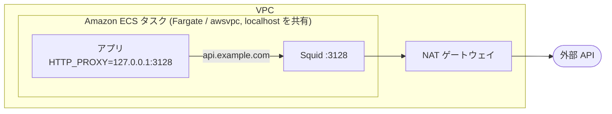
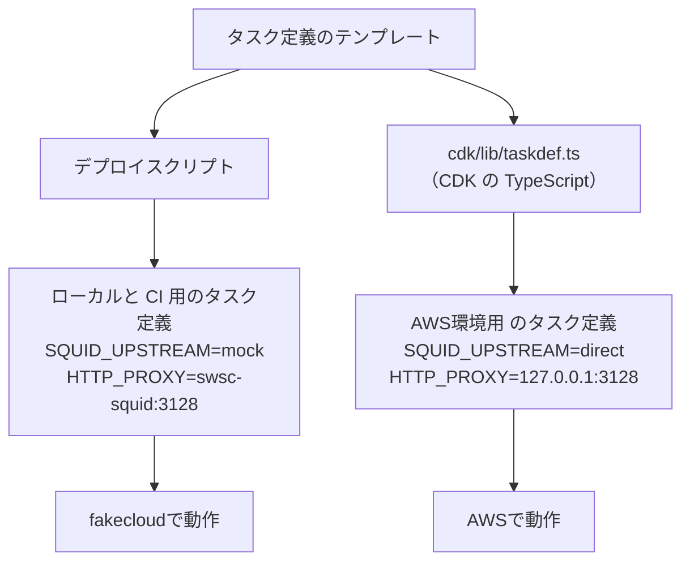
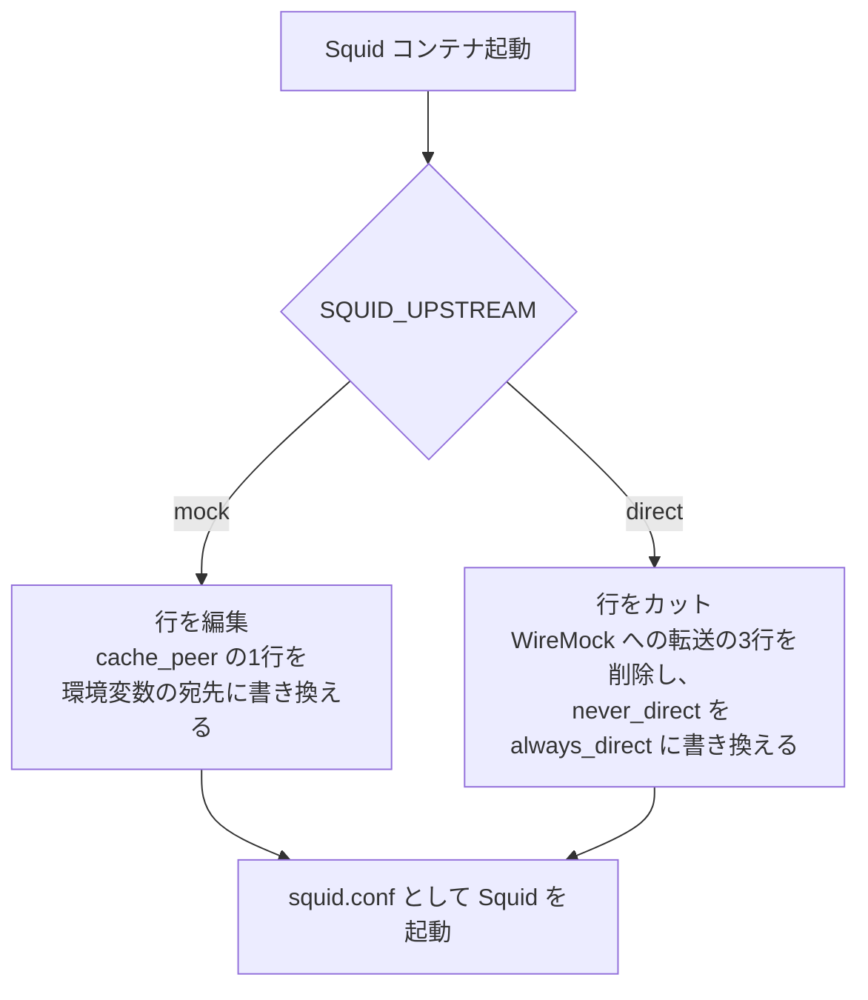
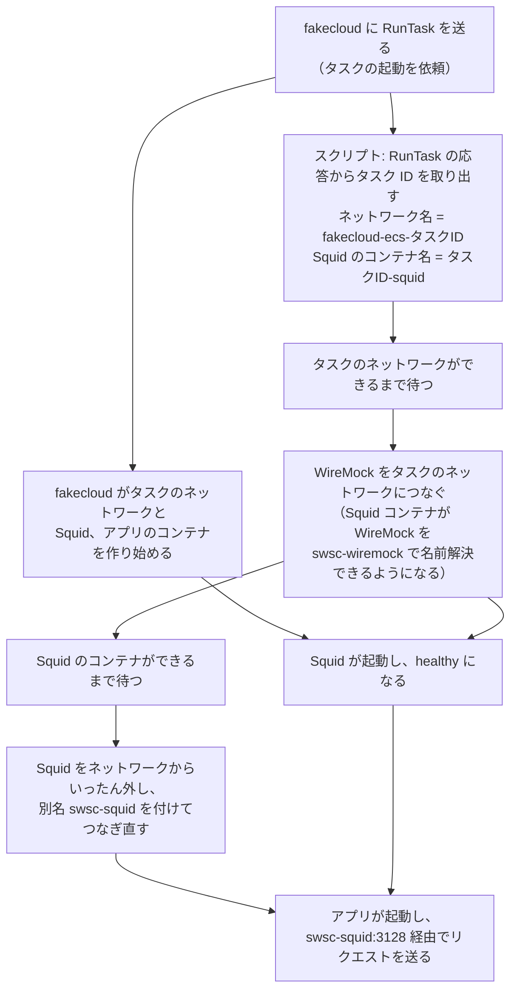
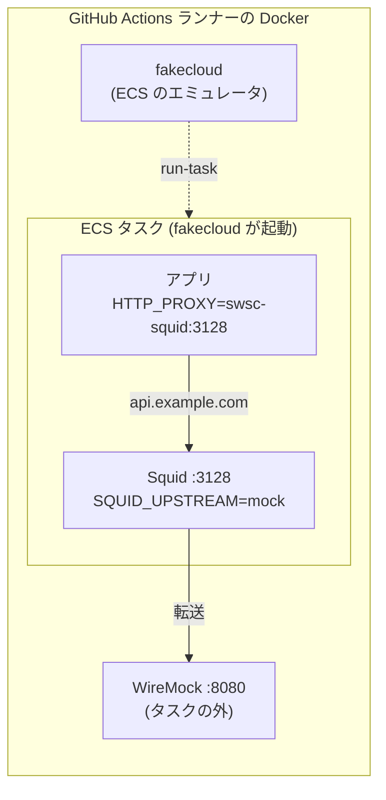
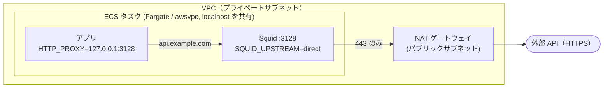

# 解説記事

## はじめに

本記事の検証で作ったものは、次の3つを組み合わせたテスト基盤です。  
これらを組み合わせて、アプリケーションから外部APIへのリクエストのテストを、  
ローカルと CI と AWS で、できるだけ同じタスク定義で行うことを目指して組んでみました。  

| 要素 | 役割 |
| --- | --- |
| Squid（サイドカー） | アプリの外部 API 宛てのリクエストを、許可したドメインだけ通します |
| WireMock | 外部 API の代わりに、正常な応答、エラー、遅延を返します |
| fakecloud | ECS のエミュレータです。AWS と同じタスク定義を、ローカルと CI で動かします |

```text
アプリ → Squid (:3128) → WireMock (:8080)      ローカル、CI
アプリ → Squid (:3128) → 外部 API（HTTPS）       AWS（WireMock なし）
```

本記事においてはAWSの各種サービスを以下のように略して記載します。  

| 正式名称 | 本記事での表記 |
| --- | --- |
| Amazon Elastic Container Service | ECS |
| AWS Fargate | Fargate |
| Amazon Virtual Private Cloud | VPC |
| NAT gateway（Amazon VPC） | NAT ゲートウェイ |
| Amazon CloudWatch Logs | CloudWatch Logs |
| AWS Cloud Development Kit | CDK |
| AWS Identity and Access Management | IAM |

なお、本記事におけるCIとは、GitHub Actionsによるワークフローだと捉えてください。  
アプリケーションはアプリと記述します。  

本記事の検証コードはこちらにアップしています。  
本記事では、このアップしてある検証コードを検証リポジトリと表現します。  

[https://github.com/satoshi256kbyte/squid-wiremock-sidecar:embed:cite]

ディレクトリ構成は次の通りです。  

```text
.
├── .github/workflows/
│   └── e2e-test.yml                    # CI（GitHub Actions）のワークフロー
├── cdk/                                # AWS にデプロイするための CDK（TypeScript）
│   ├── bin/app.ts                      #   エントリポイント
│   └── lib/
│       ├── sidecar-stack.ts            #   スタック
│       ├── taskdef.ts                  #   タスク定義の生成
│       └── assets.ts                   #   Squid のイメージなどの用意
├── ecs/
│   ├── task-definition.template.json   # タスク定義の雛形（ローカル、CI、AWS で共通の元）
│   └── squid/                          # Squid のイメージ
│       ├── Dockerfile
│       ├── entrypoint.sh               #   起動スクリプト
│       └── derive-config.sh            #   環境ごとの設定（転送先など）を作る
├── squid-config/
│   ├── squid.conf                      # Squid の設定
│   └── whitelist.txt                   # 許可するドメインの一覧
├── test-client/                        # アプリの代わりのテスト用クライアント
│   ├── entrypoint.sh                   #   外部 API を叩く
│   └── retry-lib.sh                    #   リトライとタイムアウト
├── wiremock-scenarios/                 # WireMock のシナリオ
│   ├── mappings/                       #   リクエストと応答の対応（JSON）
│   └── __files/                        #   応答の本文
├── scripts/                            # テストの実行スクリプト
│   ├── e2e.sh                          #   入口（起動、テスト、停止）
│   ├── e2e-scenarios.sh                #   シナリオの実行
│   ├── e2e-taskdef.py                  #   雛形からタスク定義を生成
│   └── ...                             #   共通部品（e2e-lib.sh など）
├── docs/                               # テスト方式、AWS へのデプロイ手順など
├── Dockerfile.test-client              # テスト用クライアントのイメージ
└── package.json                        # npm run start / test などの入口
```

### 本記事のスコープと制約

本記事では、外部 API へリクエストを送るアプリを、Amazon ECS on AWS Fargate のタスクで動かすものとしています。  
そのうえで、次の制約を受け入れて構成しています。  

| 区分 | 内容 |
| --- | --- |
| 対象外 | ECS のサービスとしての動作は、検証していません |
| 対象外 | ローカルと CI では、モックへの通信に HTTPS ではなく HTTP を使い、HTTPS のテストは見送っています |
| 回避策 | fakecloud は同じタスクのコンテナで localhost を共有できないため、ネットワークの別名を付けて補っています |

### 本記事の内容の検証環境

本記事の検証環境を記載します。  

ローカルPCは以下の通りです。  

| 項目 | 版・内容 |
| --- | --- |
| OS | macOS 26.6.2 |
| CPU | Apple M5（Apple silicon、arm64） |
| メモリ | 24 GB |

ツール・ライブラリとそのバージョンは以下の通りです。  
バージョンは、本記事執筆時点のものです。  
Squid は `ubuntu/squid:latest` を元にしたイメージのため、版を固定していません。  

| 項目 | 版・内容 |
| --- | --- |
| Node.js | v26.13.0 |
| Python | 3.14.6 |
| Squid | 6.13 |
| WireMock | 3.13.1 |
| fakecloud | 0.51.0 |

## Amazon ECS と Squid によるコンテナのサイドカー戦略

### 外部 API へのリクエストを制御する

外部 API と通信するシステムでは、「どこへ出ていけるか」を制御したいことが多いです。  
セキュリティグループとネットワーク ACL は、IP アドレスとポートで制御します。しかし、外部 API の IP は変わるうえ、  
CDN の裏にあれば、同じ IP を多数のドメインが共有します。ドメインで制御するには、アプリ層のプロキシが必要です。  

ECS のサイドカーパターンは、これに向いています。同じタスクに Squid のコンテナを置くことで、外部APIへのリクエストを制御します。  



ECS on Fargateのタスク定義で、同一タスクでアプリとSquidを動かします。  
そして、アプリ側で環境変数を用いてプロキシサーバーにSquidを指定します。  

Linux では、環境変数 `HTTP_PROXY`（HTTPS 用は `HTTPS_PROXY`）にプロキシの URL を設定する方法が広く使われています。  
curl をはじめ、多くのコマンドやライブラリがこの環境変数を読みます。  
従って、この仕組みを利用します。  

ECSの`awsvpc` ネットワークモードでは、同じタスクのコンテナが localhost を共有できます。  
これを利用し、`HTTP_PROXY=http://127.0.0.1:3128` を渡します。  
これでアプリ側のプロキシサーバーがSquidになり、外部へのリクエストがSquidを通るようになります。  

同一タスクでアプリとSquidを動かし、プロキシサーバーにSquidを指定するECS on Fargateのタスク定義は以下のようになります。  

```jsonc
{
  "family": "swsc-e2e",
  "networkMode": "awsvpc",            // 同じタスクのコンテナが localhost を共有する
  "requiresCompatibilities": ["FARGATE"],
  "cpu": "512",
  "memory": "1024",
  "containerDefinitions": [
    {
      "name": "client",
      "image": "{{CLIENT_IMAGE}}",    // デプロイ時にアプリのベースとなるコンテナイメージを入れます
      "essential": false,             // アプリが終わっても、それだけではタスクを止めない
      "environment": [
        { "name": "HTTP_PROXY", "value": "http://127.0.0.1:3128" },   // 外部へのリクエストを Squid に向ける
        { "name": "HTTPS_PROXY", "value": "http://127.0.0.1:3128" },
        { "name": "NO_PROXY", "value": "localhost,127.0.0.1" },
        { "name": "TEST_API_BASE_URL", "value": "http://api.example.com" }
      ],
      "dependsOn": [{ "containerName": "squid", "condition": "HEALTHY" }]  // Squid が healthy になってから起動
    },
    {
      "name": "squid",
      "image": "{{SQUID_IMAGE}}",   // デプロイ時にSquidのコンテナイメージを入れます
      "essential": true,
      "environment": [{ "name": "SQUID_UPSTREAM", "value": "{{SQUID_UPSTREAM}}" }],  // 検証リポジトリ独自の変数。mock は Squid の転送先が WireMock、direct は外部 API
      "healthCheck": {
        "command": ["CMD-SHELL", "bash -c 'exec 3<>/dev/tcp/127.0.0.1/3128'"],  // 3128 に接続できれば healthy
        "interval": 5, "timeout": 3, "retries": 5, "startPeriod": 10
      }
    }
  ]
}
```

タスク定義中の`networkMode`、`dependsOn`、`healthCheck` などの意味は、AWS の次のドキュメントを参照してください。  

- [Amazon ECS タスク定義のパラメータ（Fargate）](https://docs.aws.amazon.com/AmazonECS/latest/developerguide/task_definition_parameters.html)
- [Fargate タスクのネットワーク（awsvpc）](https://docs.aws.amazon.com/AmazonECS/latest/developerguide/fargate-task-networking.html)

Squid側は設定でリクエストの制御を行います。  
例えば、リクエストを許可するドメインをホワイトリスト形式で設定できます。  

Squid の設定は `squid.conf` に書きます。  
ドメインの許可には、`acl`（条件の名前付け）と `http_access`（条件に合うリクエストの許可・拒否）を使います。  
詳しくは、Squid の公式ドキュメントの  
[acl](https://www.squid-cache.org/Doc/config/acl/) と  
[http_access](https://www.squid-cache.org/Doc/config/http_access/) を参照してください。  

検証リポジトリの `squid-config/squid.conf` の該当部分は、次のとおりです。  

```text
acl api_domains dstdomain "/etc/squid/whitelist.txt"
acl local_src src 127.0.0.0/8 10.0.0.0/8 172.16.0.0/12 192.168.0.0/16
http_access allow local_src api_domains
http_access deny all
```

1行目は、宛先ドメインが `whitelist.txt` に載っているリクエストを `api_domains` と名付けます。  
`dstdomain` の引数にファイルを指定すると、1行1ドメインのリストとして読み込まれます。  
2行目は、送信元が自分自身やプライベートアドレスのリクエストを `local_src` と名付けます。  
3行目で `local_src` かつ `api_domains` のリクエストだけを許可し、4行目で残りをすべて拒否します。  

ホワイトリストは`whitelist.txt`としてファイルを用意します。  
検証リポジトリでは以下のように配置しており、SquidコンテナのDockerfileの`COPY`でSquidの中に送り込みます。  
`COPY whitelist.txt /etc/squid/whitelist.txt`の部分です。  

```text
squid-config/
├── squid.conf          # ルール（acl、http_access、cache_peer など）
└── whitelist.txt       # 許可するドメインの一覧
ecs/squid/
├── Dockerfile          # 上の2つと下の2つのスクリプトをイメージに入れる
├── derive-config.sh    # 起動時に squid.conf を環境に合わせて書き換える
└── entrypoint.sh       # 書き換え → 構文確認 → Squid 起動
```

```dockerfile
FROM ubuntu/squid:latest
COPY squid.conf /etc/squid/squid.conf.src
COPY whitelist.txt /etc/squid/whitelist.txt
COPY derive-config.sh /usr/local/bin/swsc-derive-config.sh
COPY entrypoint.sh /usr/local/bin/swsc-entrypoint.sh
RUN chmod 0755 /usr/local/bin/swsc-derive-config.sh /usr/local/bin/swsc-entrypoint.sh
ENTRYPOINT ["/usr/local/bin/swsc-entrypoint.sh"]
```

ドメインを増やす時は、`whitelist.txt`を編集してイメージを作り直します。  
`squid.conf` は `squid.conf.src` として置き、起動時に派生させたものが実際の `squid.conf` になります（後述します）。  

なお、制約もあります。  
Squid が見えるのは、宛先のホストとポートだけです。  
HTTPS では、トンネルの中のパスやステータスコードは見えません（HTTP のリクエストなら見えます）。  
また、アプリが `HTTP_PROXY` を使わずに外部へ直接接続すると、この制御は効きません。  

### 外部 API と通信する機能におけるテストの課題

ローカルとCIでテストを行うとした場合、その時点で実際の外部APIにリクエストを送るのは抵抗があります。  
安定してないクライアントアプリで外部APIを叩くと、レートリミット超えなどが心配です。  
また、外部 API と通信する機能は、正常系よりも、異常系の振る舞いにバグが出やすいです。  

- 500 や 503 が返ったときに、リトライするか。待ち時間は妥当か。回数に上限はあるか。
- 429 が `Retry-After` を付けて返ったときに、その秒数に従うか。
- 応答が遅いときに、タイムアウトするか。リトライしないか。

これらを本物の API で確かめるのは難しいです。  
エラーを任意のタイミングで起こせず、レート制限は本番の枠を使い、結果は毎回変わります。  

本番と同じ「プロキシを通る経路」で、なんとかして正常・異常の両方のリクエストと応答を再現する必要があります。  

### WireMock による HTTP ベースの API モックサーバー

WireMock は、HTTP のモックサーバーです。  

[https://wiremock.org/:embed:cite]

WireMockのスタブ（リクエストに対する応答の定義）が、この記事でやりたいテストに有効で、  
その内容は、[Stubbing](https://wiremock.org/docs/stubbing/) に書かれています。  

WireMockのスタブはリクエストと応答の対応を JSON で書きます。  
本記事では、このスタブ1つ（または状態を持つ一組）をテストの単位として「シナリオ」と呼びます。  
なお、WireMock の用語でのシナリオ（ Scenario ）は、状態を持つスタブを指します。  
たとえば「最初の1回は 500、2回目から 200」というシナリオは以下のように書きます。  

```json
{
  "name": "error-500-then-200",
  "scenarioName": "error-500-then-200",
  "requiredScenarioState": "Started",
  "newScenarioState": "Succeeded",
  "request": { "method": "GET", "urlPath": "/api/error-500-then-200" },
  "response": { "status": 500, "bodyFileName": "error-500.json" }
}
```

状態を持つシナリオは [Stateful Behaviour](https://wiremock.org/docs/stateful-behaviour/)、  
遅延やエラーの再現は [Simulating Faults](https://wiremock.org/docs/simulating-faults/)、  
管理 API は [Administration API](https://wiremock.org/docs/api/) を参照してください。  

検証リポジトリでは、WireMock の設定とシナリオは以下のように置いています。  

```text
wiremock-scenarios/
├── mappings/                      # リクエストと応答の対応（JSON、1シナリオに1〜2ファイル）
│   ├── normal-case.json
│   ├── error-500-then-200-1.json  # 1回目: 500（Started → Succeeded）
│   ├── error-500-then-200-2.json  # 2回目以降: 200（Succeeded）
│   ├── error-429-case.json
│   └── delay-5000ms-case.json
└── __files/                       # 応答の本文（bodyFileName が指すファイル）
    ├── success.json
    └── error-500.json など
```

WireMock のコンテナを起動する際、このディレクトリを読み取り専用で渡します。  
WireMock の Docker イメージは、`/home/wiremock` 配下の `mappings/` と `__files/` を起動時に読みます。  

```sh
docker run -d --name swsc-wiremock --label "$SWSC_LABEL" --label swsc.role=wiremock \
  -p "127.0.0.1:${SWSC_MOCK_PORT}:8080" \
  -v "$SWSC_ROOT/wiremock-scenarios:/home/wiremock:ro" \
  "$SWSC_WIREMOCK_IMAGE"
```

コード中の `$SWSC_...` は、E2E の共通処理のシェルで定義した変数です。  

| 変数 | 内容 |
| --- | --- |
| `SWSC_LABEL` | `swsc.managed=true`。検証リポジトリが作った Docker 資源に付ける目印で、後片付けで自分が作ったものだけを探して消すために使います |
| `SWSC_MOCK_PORT` | WireMock をホストに公開するポート番号（8080） |
| `SWSC_ROOT` | 検証リポジトリのルートディレクトリの絶対パス |
| `SWSC_WIREMOCK_IMAGE` | WireMock のイメージ（`wiremock/wiremock:3.13.1`） |

これでシナリオが有効になります。  

アプリは外部APIへのリクエストをSquidを通して行います。  
そして、SquidからWireMockにリクエストを転送するには、`squid.conf`へ以下の設定を書きます。  
（説明のため簡略化しています。実際のファイルには、`cache_peer_access wiremock deny all` の行もあります）  

```text
cache_peer wiremock parent 8080 0 no-query
cache_peer_access wiremock allow api_domains
never_direct allow api_domains
```

Squid の設定項目 [cache_peer](https://www.squid-cache.org/Doc/config/cache_peer/) は、  
転送先（親プロキシ）を指定します。  
ここでは、転送先として WireMock（`wiremock`、ポート 8080）を登録します。  
`cache_peer_access` で、ホワイトリストのドメインのリクエストだけをこの転送先に送るようにします。  
`never_direct` は、ホワイトリストのドメインを、転送先を使わずに直接つなぐことを禁じる設定です  
（[never_direct](https://www.squid-cache.org/Doc/config/never_direct/)）。  
これで、今回テストする外部API宛てのリクエストは、必ず WireMock に届きます。  

## ローカルと CI、そして AWS 環境においてできるだけ同じ定義でテストする

テスト環境を `docker run` や Docker Compose で別に組むと、本番のタスク定義とずれます。  
タスク定義はじめとして、環境変数・依存関係など数多の要因が違えばテストで動いても本番で動くかどうかは不安です。  
そこで、ローカルと CI でも、AWS と同じタスク定義を、ECSで実行することにします。  
そのために、ECS のエミュレータを使います。  

### fakecloud による AWS 環境のエミュレーション

fakecloud は、AWS のエミュレータです。ECS の API を受け、タスクのコンテナを Docker で実際に起動します。  

[https://github.com/faiscadev/fakecloud:embed:cite]

動かすには、次の準備が必要です。  

#### Docker のソケットを渡す

fakecloud 自身もコンテナで動きます。  
タスクのコンテナを起動するには、fakecloud が、ホストの Docker に「このコンテナを起動して」と頼む必要があります。  
その窓口が、ホストの Docker のソケット（`/var/run/docker.sock`）です。  
fakecloud のコンテナにこのファイルをマウントして渡します。  

```sh
docker run -d --name swsc-fakecloud --label "$SWSC_LABEL" --label swsc.role=fakecloud \
  -p "127.0.0.1:${SWSC_FAKECLOUD_PORT}:4566" \
  -v /var/run/docker.sock:/var/run/docker.sock --add-host host.docker.internal:host-gateway \
  "$SWSC_FAKECLOUD_IMAGE"
```

`SWSC_FAKECLOUD_PORT` は fakecloud をホストに公開するポート番号（14566）、  
`SWSC_FAKECLOUD_IMAGE` は fakecloud のイメージ（版を固定しています）です。  
`SWSC_LABEL` は前述の表の説明の通りです。  

Docker のソケットに関する詳細は、  
Docker の[セキュリティのドキュメント](https://docs.docker.com/engine/security/#docker-daemon-attack-surface)を参照してください。  

#### ローカルにレジストリを作ってコンテナイメージを置く

ここで言うレジストリは、コンテナイメージの置き場です。  
`docker build` で作った Squid とアプリのイメージは、手元の Docker にしかありません。  
fakecloud はイメージを取得（pull）しようとした時、ローカルにしか無いイメージを拒否し、タスクが `TaskFailedToStart` となります。  
従って、擬似的にローカルでないコンテナイメージの置き場を作る必要があります。  

そこで、公式の [registry イメージ](https://hub.docker.com/_/registry) を起動し、  
ビルドしたイメージを push しておきます。  

```sh
docker run -d --name swsc-registry --label "$SWSC_LABEL" --label swsc.role=registry \
  -p "127.0.0.1:${SWSC_REGISTRY_PORT}:5000" "$SWSC_REGISTRY_IMAGE"
docker tag "$_i:e2e" "$SWSC_REGISTRY_HOST/$_i:e2e"
docker push "$SWSC_REGISTRY_HOST/$_i:e2e"
```

| 変数 | 内容 |
| --- | --- |
| `SWSC_REGISTRY_PORT` | レジストリをホストに公開するポート番号（15000） |
| `SWSC_REGISTRY_IMAGE` | レジストリのイメージ（`registry:2.8.3`） |
| `SWSC_REGISTRY_HOST` | レジストリの宛先（`localhost:15000`）。イメージ名の先頭に付けて、push 先を決めます |
| `$_i` | イメージ名を順に入れるループ変数（`swsc-client` と `swsc-squid`）。実際のスクリプトは `for _i in ...; do` で2つのイメージを繰り返し処理します |

15000 は、検証リポジトリで決めた固定のポート番号です。  
タスク定義の `image` には、`localhost:15000/...` で始まる参照を書きます。  

#### WireMock を別に起動する

WireMock は、タスク定義に入れず、タスクの外のコンテナとして起動します。  
理由は、WireMock は AWSの本番環境にはいらないので、タスク定義に余計なものを入れないためです。  
タスク定義に含めると、AWS 用の定義とローカルの定義で分岐してしまうのでこれを避けます。  

fakecloud は、ECS の API を受けて、タスクをコンテナとして起動します（[README](https://github.com/faiscadev/fakecloud)）。  
ECS のネットワークの細かな挙動は README に記載がなかったため、本検証では動かして確かめました。  

### タスク定義はテンプレートを設けて環境ごとに生成する

タスク定義は環境ごとに成立するとテストが非効率になります。  
とはいえ、完全に一つにするのは私にはできなかったので、  
テンプレート：`ecs/task-definition.template.json`を設けて、それを元に各環境用に生成する形にしました。  

テンプレートは以下の内容です。  
（上述したものと同じです）  

```jsonc
{
  "family": "swsc-e2e",
  "networkMode": "awsvpc",            // 同じタスクのコンテナが localhost を共有する
  "requiresCompatibilities": ["FARGATE"],
  "cpu": "512",
  "memory": "1024",
  "containerDefinitions": [
    {
      "name": "client",
      "image": "{{CLIENT_IMAGE}}",    // デプロイ時にアプリのベースとなるコンテナイメージを入れます
      "essential": false,             // アプリが終わっても、それだけではタスクを止めない
      "environment": [
        { "name": "HTTP_PROXY", "value": "http://127.0.0.1:3128" },   // 外部へのリクエストを Squid に向ける
        { "name": "HTTPS_PROXY", "value": "http://127.0.0.1:3128" },
        { "name": "NO_PROXY", "value": "localhost,127.0.0.1" },
        { "name": "TEST_API_BASE_URL", "value": "http://api.example.com" }
      ],
      "dependsOn": [{ "containerName": "squid", "condition": "HEALTHY" }]  // Squid が healthy になってから起動
    },
    {
      "name": "squid",
      "image": "{{SQUID_IMAGE}}",   // デプロイ時にSquidのコンテナイメージを入れます
      "essential": true,
      "environment": [{ "name": "SQUID_UPSTREAM", "value": "{{SQUID_UPSTREAM}}" }],  // 検証リポジトリ独自の変数。mock は Squid の転送先が WireMock、direct は外部 API
      "healthCheck": {
        "command": ["CMD-SHELL", "bash -c 'exec 3<>/dev/tcp/127.0.0.1/3128'"],  // 3128 に接続できれば healthy
        "interval": 5, "timeout": 3, "retries": 5, "startPeriod": 10
      }
    }
  ]
}
```

環境ごとの完成版は、このテンプレートから作ります。  
ローカルと CI は、デプロイスクリプトで、AWS は CDK（`cdk/lib/taskdef.ts`）で、同じテンプレートを読み込んで変数展開してからタスク定義として使用します。  



### ローカル環境の通信経路とその仕組み


ローカル環境では、前項で紹介したデプロイスクリプトでタスク定義を作り、AWS環境をエミュレーションしたfakecloudに対してデプロイします。  
fakecloudはアプリとSquidをECSのタスクで起動、まずこの2つはfakecloudにより専用の Docker ネットワークに入るので繋がります。  

#### Squid の設定は起動時に環境変数から書き換わる

Squid から WireMock への転送は、タスク定義ではなく、Squid の設定（`squid.conf`）で決まります。  
タスク定義が渡すのは、環境変数 `SQUID_UPSTREAM=mock` と、WireMock の宛先（`SQUID_MOCK_HOST=swsc-wiremock`、  
`SQUID_MOCK_PORT=8080`）だけです。  
この2つの宛先は、テンプレートにはなく、ローカルと CI 用のタスク定義を生成するときに足されます。  
この値を使って、デプロイ後の Squid コンテナの起動の過程で `squid.conf` を書き換えます。  
書き換えは、Squid のイメージに組み込んだ起動処理（シェルスクリプト）が行います。  

```dockerfile
FROM ubuntu/squid:latest
COPY squid.conf /etc/squid/squid.conf.src
COPY whitelist.txt /etc/squid/whitelist.txt
COPY derive-config.sh /usr/local/bin/swsc-derive-config.sh
COPY entrypoint.sh /usr/local/bin/swsc-entrypoint.sh
RUN chmod 0755 /usr/local/bin/swsc-derive-config.sh /usr/local/bin/swsc-entrypoint.sh
# ここで呼ばれるスクリプトの中でSquidの設定ファイルを書き換える
ENTRYPOINT ["/usr/local/bin/swsc-entrypoint.sh"] 
```

起動時の処理の流れは以下の通りです。  



検証リポジトリの `squid.conf` は、書き換えの元になるテンプレートです。  
イメージには `/etc/squid/squid.conf.src` として入っていて、Squid が直接読むことはありません。  
起動の過程で、このテンプレートの `cache_peer` の1行だけを書き換え、  
その結果を `squid.conf` として Squid が読みます。  

`mock` のとき、テンプレートの行は次のように書き換わります。  
`SQUID_MOCK_HOST` と `SQUID_MOCK_PORT` の値が入ります。  

```text
# テンプレート（squid-config/squid.conf）
cache_peer wiremock parent 8080 0 no-query

# 実際に Squid が読む行
cache_peer swsc-wiremock parent 8080 0 no-query name=wiremock
```

`swsc-wiremock` は、WireMock のコンテナ名です。  
この記述は、「`swsc-wiremock:8080` を親プロキシ（転送先）として登録し、`wiremock` と名前をつける」という意味です。  
これによりSquidからWireMockへリクエストが転送されるようになります。  

テンプレートとの違いは、接続先のホスト名が `swsc-wiremock` になった点と、`name=wiremock` を足した点です。  
`cache_peer` は、`name=` がないと、ホスト名をそのまま転送先の名前にします。  
ホスト名を書き換えると名前も変わってしまい、`cache_peer_access wiremock ...` の行が  
転送先を見失います。そこで `name=wiremock` を足して、名前を固定しています。  
`cache_peer_access` の行は書き換えずに、そのまま使えます。  

#### WireMock をタスクのネットワークにつなぐ

SquidからWireMockへリクエストが転送される設定は書きましたが、  
Squid が実際に転送するには、WireMockが `swsc-wiremock` という名前で Squid と同じネットワークにいる必要があります。  
これについては、タスク定義とfakecloudで自然な形では再現できなかったので、後付けで設定することにしました。  
以下のフローチャートを再現したスクリプトで後付け設定を行います。  



後付けスクリプトは、`RunTask` を送った直後から動き始めるような作りにしています。  
タスクの起動と並行して、ネットワークとコンテナができるのを待ち、できた順につなぎます。  
WireMock の接続は、Squid が起動して名前を引く前に済ませます。  
アプリは `dependsOn: HEALTHY` で Squid が healthy になるまで起動しません。  
その間に別名を付けるので、通常は、別名が付く前にアプリがリクエストを送ることはありません。  

### CI（GitHub Actions）の通信経路とその仕組み



GitHub Actions による CI の通信経路と挙動は、ローカルと同じです。  
違うのは、動く場所が GitHub のランナー（`ubuntu-24.04`）であることと、実行するのが開発者ではなくワークフローであることだけです。  

### AWS にデプロイした場合の通信経路とその仕組み



AWS では、WireMock を置きません。  
Squid は外部 API へ直接つなぎます。  
アプリは `127.0.0.1:3128` で、ECSの同じタスクで動く Squid にリクエストが届きます。  

AWS環境用のタスク定義もテンプレートから作りますが、AWS環境用はIaCにCDKを使い、TypeScriptで書きます。  
ロードして変数展開するのはローカルと同じです。  
主な違いは、SquidにWireMockへの転送設定をするか否かの環境変数（`SQUID_UPSTREAM`）の値です。  
ほかに、ログ設定などの AWS 固有の値を足します。  
`cdk/lib/taskdef.ts` が、テンプレートの JSON を読み込み、`fill` 関数で `{{...}}` を値で埋めます。  
そのあと、ログ設定などの AWS 固有の値を足して、タスク定義の props を返します。  
スタック（`cdk/lib/sidecar-stack.ts`）は、この props から `CfnTaskDefinition` を生成します。  
以下、検証リポジトリのソースコードを抜粋します。  

```typescript
// テンプレートの {{名前}} を値で埋める。文字列全体が {{名前}} のときだけ置き換え、未知の名前は拒否する。
function fill(node: Json, values: Record<string, string>): Json {
  // 中身は省略
}

export function buildTaskDefinitionProps(input: TaskDefinitionInput): ecs.CfnTaskDefinitionProps {
  // テンプレート（ecs/task-definition.template.json）を読み込む
  const template = asObject(JSON.parse(fs.readFileSync(input.templatePath, 'utf-8')) as Json, 'タスク定義のテンプレート');
  rejectUnknown(template, TOP_KEYS, 'トップレベル');

  // fill関数でテンプレートの変数展開
  // この時、SQUID_UPSTREAM 変数は direct に固定する。
  // これにより、Dockerfileから呼ばれるSquidの設定変更スクリプトが、AWS 用にWireMock を使わない設定にしてくれる。
  const filled = asObject(
    fill(template, {
      CLIENT_IMAGE: input.clientImage,
      SQUID_IMAGE: input.squidImage,
      SQUID_UPSTREAM: 'direct',
    }),
    'タスク定義',
  );

  // ...（ログ設定などの AWS 固有の値を足して、タスク定義（CfnTaskDefinition）の props として返す）
}
```

`SQUID_UPSTREAM` を `'direct'` に固定するのが、ローカルとの違いです。  
これで Squid は WireMock に転送せず、外部 API に直接つなぎます。  

## ローカルと CI では HTTPS でのテストを見送り

本記事の検証ではローカルと CI では、HTTP で WireMock を叩くことにしました。  
HTTPS では叩きません。  

HTTPS のリクエストは、アプリが `CONNECT` で Squid にトンネルを頼みます。  
`mock` では、Squid は許可ドメインのリクエストを、`cache_peer` の  
WireMock（8080、平文の HTTP のモック）へ転送します。  
このポートは、`CONNECT` で張ったトンネルの先で TLS の通信ができる相手ではないため、  
成立しない見込みです。  

`CONNECT` は、HTTP のリクエストメソッドの1つです。  
プロキシに「この宛先とのトンネルを開いてほしい」と頼み、以降はプロキシが中身を見ずにバイト列を中継します  
（[MDN: CONNECT](https://developer.mozilla.org/ja/docs/Web/HTTP/Reference/Methods/CONNECT)）。  
HTTPS では、トンネルの先で、アプリと外部 API が TLS（暗号化）の通信を直接行います。  

WireMock には、プロキシとして使う設定や、TLS 用のポートもありますが、本記事の検証の構成では未使用です。  
WireMock を TLS 対応にして、Squid から証明書を信頼させる方法はあります。  
しかし、Squid の復号や証明書の配布が必要になり、  
本番の構成から離れるため対象外とした次第です。  
テストでしたかったリトライとタイムアウトの検証にはプロトコルの違いは影響しないと考え、見送りました。  

## WireMockによるテストシナリオの内容

以上の構成で、ローカルとCIでWireMockを活用したテストを動かすようにしました。  
テストは「シナリオ」という単位で実行します。  
アプリは、テスト用ドメイン（`api.example.com`）の後ろに表のパスを付けて外部 API を叩きます。  
WireMock は、そのパスごとに、シナリオで決めた応答を返します。  
テストコードは、アプリの結果（試行回数と終了コード）が期待どおりかを確かめます。  
冒頭述べた通り例外系はこういう仕組みを作っておくと便利ですね。  

次の4つが、実際にテストで実行しているシナリオです。  

| シナリオ | パス | WireMock の応答 | 備考 |
| --- | --- | --- | --- |
| `normal` | `/api/users/123` | 200 | リトライしない |
| `error-500-then-200` | `/api/error-500-then-200` | 1回目 500、2回目以降 200 | 5xx（500、503）は最大 3 回リトライ。待ちは 1、2、4 秒 |
| `ratelimit-429` | `/api/ratelimit` | 429（`Retry-After: 2`）が続く | 最大 3 回リトライ。待ちは `Retry-After` の秒数 |
| `slow-5000` | `/api/slow-5000` | 5 秒遅延の 200 | タイムアウトはリトライしない |

WireMock には、次の3つのシナリオも定義してありますが、現在のテストでは実行していません。  
今後シナリオを増やすときのために置いています。  

| パス | WireMock の応答 |
| --- | --- |
| `/api/slow-100` | 100 ミリ秒遅延の 200 |
| `/api/error-500` | 常に 500 |
| `/api/error-503` | 常に 503 |

### アプリのE2Eのテストケース

アプリが外部 API を叩く E2E を、次の4つのケースで実行します。  
各ケースで、叩く API のパスに、表のシナリオを適用します。  
以下の「試行」は、最初の1回とリトライの合計回数です。  

#### 正常系

正常系で叩く API のパス `/api/users/123` に、シナリオ `normal` を適用します。  
テストで確かめるのは、1回で成功し、リトライしないこと（試行 1）です。  

#### 一時的な 5xx

一時的な 5xx で叩く API のパス `/api/error-500-then-200` に、シナリオ `error-500-then-200` を適用します。  
呼び出し回数で応答が変わるため、状態を持つシナリオとして定義しています。  
テストで確かめるのは、1回リトライして成功すること（試行 2）です。  

#### レート制限

レート制限で叩く API のパス `/api/ratelimit` に、シナリオ `ratelimit-429` を適用します。  
テストで確かめるのは、`Retry-After` の 2 秒を待って 3 回リトライし、  
それでも成功しなければ諦めること（試行 4、終了コード 0）です。  

#### タイムアウト

タイムアウトで叩く API のパス `/api/slow-5000` に、シナリオ `slow-5000` を適用します。  
このケースだけ、アプリの応答タイムアウトを 10 秒から 1 秒に下げて実行します。  
テストで確かめるのは、タイムアウトになり、リトライしないこと（終了コード 28）です。  

WireMock には、状態を初期に戻す管理 API（`POST /__admin/reset`）が標準であります。  
`error-500-then-200` は「1回目 500、2回目以降 200」と呼び出し回数で応答が変わるため、  
前のテストの影響が残らないよう、各シナリオの前にこの API を呼んでいます。  
受信の記録とシナリオの状態が初期に戻ります。  


## fakecloud の選定理由

本記事の検証では、AWS環境のエミュレーションにfakecloudを使用しています。  
ECS のエミュレータは、MiniStack、AWS Emulator（`aws/aws-emulator`）などがありますが、  
比較検討の上今回はfakecloud を選んでいます。  

比較軸は以下の通りです。  

1. ECS の API でタスク定義を実行できること。
2. コンテナを実際に起動すること。
3. `healthCheck` と `dependsOn: HEALTHY` が効くこと。
4. 同じタスクのコンテナが localhost を共有すること。

比較結果は以下の通りです。  
LocalStack は、今回は検討対象外にしています。  

| 候補 | 結果 |
| --- | --- |
| MiniStack 1.5.37 | サイドカー構成を再現できませんでした。コンテナは起動しますが、`healthCheck` と `dependsOn: HEALTHY` が効かず、アプリと Squid を両方起動する方法を見つけられませんでした |
| AWS Emulator | 公式ページと README で ECS への言及を確認できませんでした。また、リソースの状態は保持しますが、コンテナランタイムを持たず、コンテナを起動できないので、候補から外しました |
| fakecloud 0.51.0 | サイドカー構成を再現できました。コンテナを起動し、`healthCheck` と `dependsOn: HEALTHY` が効きます。別名を付ける方法が成立しました |

条件の4つ目は、確認できた範囲では、どの候補も満たしませんでした。  
そのため、アプリのプロキシを Squid の別名にして補う方式を取っています。  
最終的に fakecloud を選んだ理由は、必須の条件を満たし、その不足を最も小さい補い方で済ませられたことです。   

## まとめ

本記事では、ECS のサイドカーに置いた Squid を通る外部 API へのリクエストのテストを、  
ローカルと CI と AWS で、できるだけ同じタスク定義で行えるか試しました。  

- 外部 API を呼ぶアプリのリクエストを、本番のAWS環境と同じタスク定義かつSquid を通る経路で、テストさせることができました。
- WireMock により、500、429、遅延といった異常系を再現できました。
- Squid は、起動時に設定ファイルの調整で、転送先を WireMock と外部 API で切り替えられます。
- エミュレータは、本物の AWS と完全には同じになりません。
  今回は、fakecloud が同じタスクのコンテナで localhost を共有しないため、ネットワークの別名を付けるスクリプトで補いました。  
- ローカルと CI では、モックへの通信を HTTPS ではなく HTTP で行っています。
  WireMock を TLS 対応にすると本番の構成から離れるため、HTTPS のテストは見送りました。  

今回の検証リポジトリはかなりボリュームがあるので、記事の説明はかなり簡略化しています。  
まずは、こんなことができるんだとおもっていただければ幸いです。
